<!-- Generated by GitHub Profile Agent Console. Edit profile.config.json, then run npm run generate. -->

  <picture>
    <source media="(max-width: 760px) and (prefers-color-scheme: dark)" srcset="./assets/hero/agent-console-93586bd6-mobile-dark.svg">
    <source media="(max-width: 760px)" srcset="./assets/hero/agent-console-93586bd6-mobile-light.svg">
    <source media="(prefers-color-scheme: dark)" srcset="./assets/hero/agent-console-93586bd6-dark.svg">
    <source media="(prefers-color-scheme: light)" srcset="./assets/hero/agent-console-93586bd6-light.svg">
    
  </picture>

  

<!-- GITHUB CONTRIBUTION SNAKE ANIMATION -->

  

## About Me

I have a strong interest in network development, IoT, robotics, machine learning, and cybersecurity, and I am able to work effectively as part of a team.

My work combines technical exploration with a builder mindset: understand the problem, develop a thorough solution plan, execution, test the system, and share what actually works.

## Current Focus

| Area | What I am exploring |
| --- | --- |
| **Deep Learning** | Complex data processing, such as images (Computer Vision). |
| **Model Deployment** | apply the model to real-world systems (such as IoT devices or web applications). |
| **Software Engineering** | Design and implement software systems, including web applications and embedded systems. |

## Featured Work

| Project | Focus | Why it matters |
| --- | --- | --- |
| [**Attendance System**](https://github.com/Healme29/An-Integrated-Attendance-Solution-Merging-Wi-Fi-AP-Data-with-Two-Stage-Face-Recognition) | Computer vision for attendance tracking | This project demonstrates an integrated approach to attendance tracking using Wi-Fi AP data and two-stage face recognition. |

## Research Direction

I am interested in IoT systems that can sense physical states, autonomously actuate tools or devices, evaluate real-world outcomes, and execute bounded actions with verifiable logs and human-in-the-loop control.

## Tech Stack

`TypeScript` · `Python` · `C++` · `PyTorch` · `Arduino` · `ESP32` · `Nmap` · `Linux` · `Next.js` · `Wireshark` · `PostgreSQL` · `Hydra` · `FastAPI` · `YOLO` · `Flutter` · `Scapy ARP scan` · `YOLO` · `Burp Suite`

## Recent Activity

<!-- AUTO:ACTIVITY:START -->
- Nov 27, 2026: closed issue [#11](https://github.com/Healme29/An-Integrated-Attendance-Solution-Merging-Wi-Fi-AP-Data-with-Two-Stage-Face-Recognition/issues/11) in [Healme29/An-Integrated-Attendance-Solution-Merging-Wi-Fi-AP-Data-with-Two-Stage-Face-Recognition](https://github.com/Healme29/An-Integrated-Attendance-Solution-Merging-Wi-Fi-AP-Data-with-Two-Stage-Face-Recognition).
- Nov 27, 2026: closed issue [#9](https://github.com/Healme29/An-Integrated-Attendance-Solution-Merging-Wi-Fi-AP-Data-with-Two-Stage-Face-Recognition/issues/9) in [Healme29/An-Integrated-Attendance-Solution-Merging-Wi-Fi-AP-Data-with-Two-Stage-Face-Recognition](https://github.com/Healme29/An-Integrated-Attendance-Solution-Merging-Wi-Fi-AP-Data-with-Two-Stage-Face-Recognition).
- Nov 27, 2026: closed issue [#8](https://github.com/Healme29/An-Integrated-Attendance-Solution-Merging-Wi-Fi-AP-Data-with-Two-Stage-Face-Recognition/issues/8) in [Healme29/An-Integrated-Attendance-Solution-Merging-Wi-Fi-AP-Data-with-Two-Stage-Face-Recognition](https://github.com/Healme29/An-Integrated-Attendance-Solution-Merging-Wi-Fi-AP-Data-with-Two-Stage-Face-Recognition).
- Nov 27, 2026: closed issue [#7](https://github.com/Healme29/An-Integrated-Attendance-Solution-Merging-Wi-Fi-AP-Data-with-Two-Stage-Face-Recognition/issues/7) in [Healme29/An-Integrated-Attendance-Solution-Merging-Wi-Fi-AP-Data-with-Two-Stage-Face-Recognition](https://github.com/Healme29/An-Integrated-Attendance-Solution-Merging-Wi-Fi-AP-Data-with-Two-Stage-Face-Recognition).
- Nov 27, 2026: closed issue [#6](https://github.com/Healme29/An-Integrated-Attendance-Solution-Merging-Wi-Fi-AP-Data-with-Two-Stage-Face-Recognition/issues/6) in [Healme29/An-Integrated-Attendance-Solution-Merging-Wi-Fi-AP-Data-with-Two-Stage-Face-Recognition](https://github.com/Healme29/An-Integrated-Attendance-Solution-Merging-Wi-Fi-AP-Data-with-Two-Stage-Face-Recognition).
- Nov 27, 2026: closed issue [#5](https://github.com/Healme29/An-Integrated-Attendance-Solution-Merging-Wi-Fi-AP-Data-with-Two-Stage-Face-Recognition/issues/5) in [Healme29/An-Integrated-Attendance-Solution-Merging-Wi-Fi-AP-Data-with-Two-Stage-Face-Recognition](https://github.com/Healme29/An-Integrated-Attendance-Solution-Merging-Wi-Fi-AP-Data-with-Two-Stage-Face-Recognition).
<!-- AUTO:ACTIVITY:END -->

---

  Building thoughtful systems and sharing what works.

